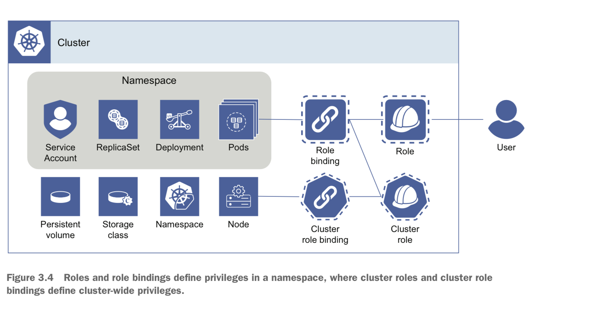

## 3. Identity and access management

Tudo que tenta acessar o Kubernetes precisa se autenticar por meio de um certificado ou token.

### Fase de autenticação

Kubernetes suporta vários tipos de métodos de autenticação. O built-in plugin que utilizamos com kubectl é chamado certificate-based authentication e utiliza um certificado X.509.

Quando uma requisição é feita para o Kubernetes API Server, ele tenta autenticar utilizando o mecanismo configurado (como client certificates, bearer token, OpenID Connect, WebHooks, etc).

### Fase de autorização

Role based access control (RBAC) é o mecanismo mais popular (mas tem outros como Node Authorization plugin, AlwaysAllow, ABAC e WebHook authorization plugin).

O modo de autorização do Kubernetes é configurado no API server com o parâmetro `--authorization-mode=RBAC`.

### Roles e role bindings

Como o RBAC funciona com base no menor acesso possível, ele sabe quais são as ações permitidas para o usuário ou grupo, com base em 4 tipos diferentes de objetos: Roles, ClusterRoles, RoleBindings e ClusterRoleBindings.

Uma role tem escopo de um namespace específico que define permissões para recursos específicos, como pods. Cada role lista ações de "allow" utilizando verbos (GET, LIST, CREATE, DELETE), que serão traduzidos em operações de API. Eles não são os mesmos que métodos HTTP, embora sejam conceitualmente similares.

Mapa de combinações suportadas entre role, role binding, cluster role e cluster role binding.

| Binding | Role |
| --- | --- |
| Cluster role binding | cluster role |
| role binding | role e cluster role |

### System roles e grupos

Algumas roles bindings criadas embutidas no cluster atribuem cluster role para alguns grupos internos como:
- system:authenticated
- system:unauthenticated
- system:masters ou kubeadm:cluster-admins