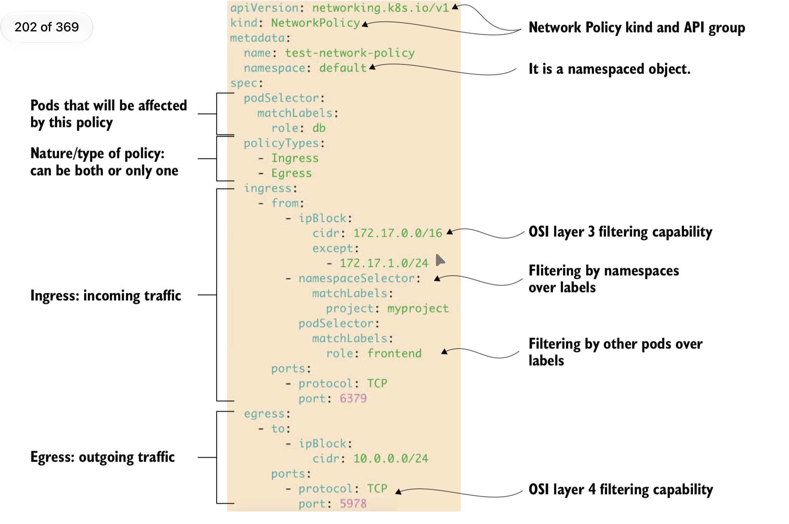

## 6. Communication in a Kubernetes cluster

### CoreDNS

Responsável por traduzir hostnames em endereços IP. Existem vários ranges de endereços IP em um cluster, e todos eles devem ser únicos.

### Ingress e ingress controllers

Para o ingress existem 3 tipos de pathtypes

- **Exact** - nesse caso o path tem que combinar exatamente o path sendo case-sensitive para dar certo
- **Prefix** - o path corresponde à URL dividido por / onde os caracteres entre as barras são o elemento
- **ImplementationSpecific** - deixa pra o `ingress class` decidir um tipo prefix ou exact path

### Services

#### ClusterIP

Feitos para deixar os pods disponíveis apenas dentro do cluster, para comunicação interna.

```yaml
apiVersion: v1
kind: Service
metadata:
  labels:
    app: internal-svc
  name: internal-svc
spec:
  clusterIP: None # headless service
  ports:
  - name: 8080-80
    port: 8080 # porta que vai estar exposto o próprio service
    protocol: TCP
    targetPort: 80 # a porta interna do container
  - name: search
    port: 9200
    protocol: TCP
    targetPort: 9200
  selector:
    app: internal-svc # selector é como o svc encontra e se "liga" ao pod
  type: ClusterIP
status:
  loadBalancer: {}
```


`headless service` -> É possível dar bypass no service indo diretamente para o pod, pra isso setamos spec.clusterIP: None, isso vai remover o endereço de IP do service e então vai retornar todos os IPs dos pods que estão atrelados. É um caso de uso útil pra databases clusters, que uma cópia do banco é responsável pela escrita e as demais só tem permissão de leitura -> statefulsets normalmente usam headless services


#### NodePort e LoadBalancer

Feitos para expor portas e criar acesso de fora do cluster, NodePort expõe uma porta no endereço de IP do node mas o LoadBalancer permite que um loadbalancer externo controle o tráfego em cada node port.

Nesse modelo, o service não apenas se comunica internamente com outros componentes do cluster, mas também consegue expor uma porta no node que pode ser utilizada para tráfego externo.

```yaml
apiVersion: v1
kind: Service
metadata:
  labels:
    app: "no"
  name: "no"
spec:
  ports:
  - name: 443-80
    nodePort: 30000 # porta exposta em cada node do cluster
    port: 443
    protocol: TCP
    targetPort: 80
  selector:
    app: "no"
  type: NodePort
status:
  loadBalancer: {}
```


#### LoadBalancer

Um service tipo load balancer, podendo ser um recurso provisionado na cloud ou on-premises.

```yaml
apiVersion: v1
kind: Service
metadata:
  labels:
    app: lb-svc
  name: lb-svc
spec:
  ports:
  - name: 8080-8080
    port: 8080
    protocol: TCP
    targetPort: 8080
  selector:
    app: lb-svc
  type: LoadBalancer
status:
  loadBalancer: {}
```


#### ExternalName

Não aloca nenhum endereço de clusterIP nele, apenas cria um registro CNAME dentro do cluster DNS

### Cluster node networking configuration

`Network Overlay` - essencialmente, são abstrações de rede "em cima" da rede que já temos no cluster. Isso existe porque cada pod dentro do cluster precisa de um IP único próprio e, muitas vezes, isso não é possível. Esse termo também pode ser encontrado como *VXLAN*.

Uma VXLAN fica no topo de uma rede física e usa encapsulação do tunnel layer-2 (OSI model) para layer-3. Durante a comunicação entre nodes, quando tentamos comunicação com um pod, esse encapsulamento ajuda a rotear para o destino correto, incluindo um header no pacote.

No cluster, quem faz isso é o CNI (container network Interface), que roda como um daemonset, criando uma camada virtual de rede no namespace, que faz um "meio de campo" entre pacotes indo de um node para outro.


### Network Policies

Mecanismo para prevenir que os pods acessem redes externas, reforçando o isolamento a nível de namespace, filtrando ingress em portas TCP específicas e restringindo a comunicação pod-to-pod.

```yaml
apiVersion: networking.k8s.io/v1
kind: NetworkPolicy
metadata:
  annotations:
  name: default-deny-all
  namespace: default
spec:
  podSelector: {} # caso seja vazio, a policy é aplicada a todos os pods do namespace
  policyTypes:
  - Ingress
  - Egress
```

Exemplos liberando tráfego de **ingress** (entrada) no pod do nginx e de **egress** (saída) no pod do busybox. Isso significa que, dando um exec no pod do busybox, é possível "chegar" ao pod do nginx.

```yaml
apiVersion: networking.k8s.io/v1
kind: NetworkPolicy
metadata:
  annotations:
  name: allow-busybox-egress
  namespace: default
spec:
  egress:
  - ports:
    - port: 80
      protocol: TCP
    to:
    - podSelector:
        matchLabels:
          run: nginx
  podSelector:
    matchLabels:
      run: busybox
  policyTypes:
  - Egress
```


```yaml
apiVersion: networking.k8s.io/v1
kind: NetworkPolicy
metadata:
  annotations:
  name: allow-nginx-ingress
  namespace: default
spec:
  ingress:
  - from:
    - podSelector:
        matchLabels:
          run: busybox
    ports:
    - port: 80
      protocol: TCP
  podSelector:
    matchLabels:
      run: nginx # define um label do pod ao qual será aplicada a NetworkPolicy
  policyTypes: # define as regras: "ingress", "egress" ou ambas
  - Ingress
```



#### Tradução

Para os pods "db" ("label role") dentro do namespace "default", permitir receber (ingress) tráfego dos pods com nome "frontend" que estão no namespace "myproject", enquanto estiverem rodando em nodes do CIDR 172.17.0.0/16, com exceção da subnet 172.17.1.0/24. Para o mesmo pod "db" no namespace "default", permitir somente tráfego de saída (egress) para o endereço 10.0.0.0 TCP da porta 5978.

> Cada item em spec.ingress[].from[] é tratado como OR.